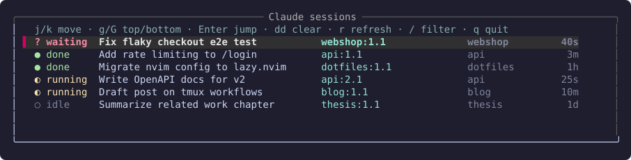

# tmux-claude-tasks

A quiet status board for [Claude Code](https://claude.com/claude-code) sessions running in tmux.

Running several Claude sessions at once means constantly checking which one finished or is
stuck on a permission prompt. Desktop notifications answer that, but they break focus.
`claude-tasks` does the opposite: Claude Code hooks silently record each session's status, and
you look at it only when *you* want to — in a tmux popup with vim keys, from which you jump
straight to the pane.



*(Screenshot rendered from `scripts/demo.sh`, which uses made-up sessions.)*

## Features

- **Every Claude session in one list**, across all tmux sessions and windows.
- **Status at a glance**, sorted by what needs you first:
  `? waiting` (permission prompt or question) → `● done` → `◐ running` → `○ idle`.
- **Readable topics** — uses the summary Claude Code puts in the pane title
  (e.g. "Fix flaky checkout e2e test"), falling back to the project folder.
- **Vim keys**, Enter to jump to the pane (switching tmux session/window as needed).
- **No notifications, no daemon.** One bash script; each hook call takes ~20 ms.
- Closed panes disappear automatically, and so do sessions whose Claude process is gone without
  its `SessionEnd` hook running (e.g. killed). This tracks the process itself, so it works when
  Claude is started through a wrapper script, and across suspend.
- **Survives a reboot with [tmux-resurrect](https://github.com/tmux-plugins/tmux-resurrect)**:
  open sessions are resumed in their panes after a restore (see below).

## Requirements

- tmux ≥ 3.3 (`display-popup`)
- A recent [fzf](https://github.com/junegunn/fzf) (uses `--no-input`, `--gutter` and `--with-shell`; tested with 0.74)
- bash, [jq](https://jqlang.org/)
- Claude Code with hooks support

## Install

1. **Put the script on your `PATH`:**

   ```sh
   git clone https://github.com/dodokr/tmux-claude-tasks.git
   ln -s "$PWD/tmux-claude-tasks/claude-tasks" ~/.local/bin/claude-tasks
   ```

2. **Add the hooks** from [`examples/claude-settings.json`](examples/claude-settings.json) to
   `~/.claude/settings.json`. If you have no other hooks, you can merge it with jq:

   ```sh
   jq -s '.[0] * .[1]' ~/.claude/settings.json tmux-claude-tasks/examples/claude-settings.json \
     > /tmp/settings.json && mv /tmp/settings.json ~/.claude/settings.json
   ```

   (`*` replaces existing hook arrays with the same event name — merge by hand if you already
   use hooks.) Restart running Claude sessions, or check `/hooks`, so they load the new hooks.

3. **Bind a key in tmux** (see [`examples/tmux.conf`](examples/tmux.conf)):

   ```tmux
   bind C-i display-popup -E -w 104 -h 60% "~/.local/bin/claude-tasks"
   bind Tab display-popup -E -w 104 -h 60% "~/.local/bin/claude-tasks"
   ```

   Terminals send `C-i` as `Tab` unless tmux `extended-keys` is on, so both are bound. This
   replaces tmux's default `prefix + Tab`; pick another key if you use that.

4. **Optional: resume sessions after a tmux-resurrect restore.** A resurrect save only holds each
   pane's command line, and for a Claude started as plain `claude` (or through a script) that
   has no session id, so resurrect can't bring the session back. `claude-tasks` knows which
   session is open in which pane; with these hooks it writes that list next to each save and,
   after a restore, types the resume command into the restored panes:

   ```tmux
   set -g @resurrect-hook-post-save-all '~/.local/bin/claude-tasks resurrect-save'
   set -g @resurrect-hook-post-restore-all '~/.local/bin/claude-tasks resurrect-restore'
   # Optional: the command typed ({id} is the session id), and 'type' to type it without
   # pressing Enter, so only the sessions you pick start ('off' disables restoring).
   set -g @claude-tasks-resume-command 'claude --resume {id}'
   set -g @claude-tasks-restore 'run'
   ```

   Only panes that are back at a shell prompt get the command; it `cd`s to the session's folder
   first if the pane is elsewhere. Don't add `claude` to `@resurrect-processes`, or sessions
   would start twice. Resurrect saves only when you press `prefix + C-s`, so pair it with
   [tmux-continuum](https://github.com/tmux-plugins/tmux-continuum) (saves every 15 minutes)
   to have a recent save when the machine goes down.

## Usage

Press your binding (`prefix + C-i` above) to open the picker.

| Key | Action |
| --- | --- |
| `j` / `k` | move down / up |
| `g` / `G` | first / last |
| `Enter` | jump to that pane |
| `dd` | remove the entry from the list |
| `r` | refresh |
| `/` | filter; `Esc` returns to normal mode |
| `s` | search all past sessions (only with [tmux-claude-sessions](https://github.com/dodokr/tmux-claude-sessions) installed) |
| `e` | a report of each session's latest reply, readable in the browser (only with [tmux-claude-reports](https://github.com/dodokr/tmux-claude-reports) installed) |
| `?` | show all keys (the header shows only the main ones) |
| `q`, `Esc`, `Ctrl+[` | close |

A `done` entry stays until you remove it with `dd`, or until you send that session a new prompt.
A removed session reappears as soon as it does something again (new prompt, reply, question).

### Statuses

| Status | Set by hook | Meaning |
| --- | --- | --- |
| `idle` | `SessionStart` | Session open, nothing to look at |
| `running` | `UserPromptSubmit`, `PostToolUse` after a prompt | Claude is working |
| `waiting` | `Notification` (`permission_prompt`, `elicitation_dialog`) | Claude needs your answer |
| `done` | `Stop` | Claude finished its reply |
| *(removed)* | `SessionEnd` | Session closed |

The "Claude is waiting for your input" idle reminder is ignored, so it never turns `done` into
`waiting`.

### Commands

```text
claude-tasks              open the picker (meant for: tmux display-popup -E)
claude-tasks hook EVENT   record a hook event (Claude Code hook JSON on stdin)
claude-tasks list         print sessions (used by the picker)
claude-tasks clear PANE   remove a session from the list until its next hook event
claude-tasks jump PANE    switch the current tmux client to that pane
claude-tasks resurrect-save | resurrect-restore
                          tmux-resurrect hooks: remember open sessions, resume them
```

### State

One small file per tmux pane in `$CLAUDE_TASKS_DIR`
(default `${XDG_STATE_HOME:-~/.local/state}/claude-tasks/`), containing
`status<TAB>epoch<TAB>cwd<TAB>session-id<TAB>process`, where *process* is `pid start` of the
process just below the pane's shell that hosts the session (Claude, or the wrapper that started
it). *start* is the process start time in clock ticks since boot, from `/proc/PID/stat`, which
tells a reused pid apart and doesn't change when the machine sleeps (unlike `ps -o lstart`,
which is the fallback on systems without `/proc`). Files whose pane no longer exists are pruned
whenever the list is shown; entries whose process no longer exists are hidden until a new
session starts in that pane. Other tools can read these files to find which pane a session is
open in —
[tmux-claude-sessions](https://github.com/dodokr/tmux-claude-sessions) uses them to jump to an open
session instead of resuming a second copy.

## Tips

- **Silence Claude's own bell.** Claude Code rings the terminal bell when it finishes, and
  tmux/your terminal may turn that into a desktop notification. To rely on `claude-tasks`
  alone, set *Notifications* to disabled in Claude Code's `/config`.
- **Interrupted tasks** (Esc in Claude) may not fire `Stop`, leaving the entry `running` — `dd`
  removes it.

## Development

```sh
tests/test.sh              # hook, list and resurrect hooks with fake Claude processes on an isolated tmux server
scripts/demo.sh            # try the picker on an isolated tmux server with fake sessions
CAPTURE_ANSI=1 scripts/demo.sh --capture | scripts/ansi2svg.py > docs/screenshot.svg
```

The demo runs on its own tmux socket and a temporary state directory, so it never touches
your real sessions.

## License

[MIT](LICENSE)
